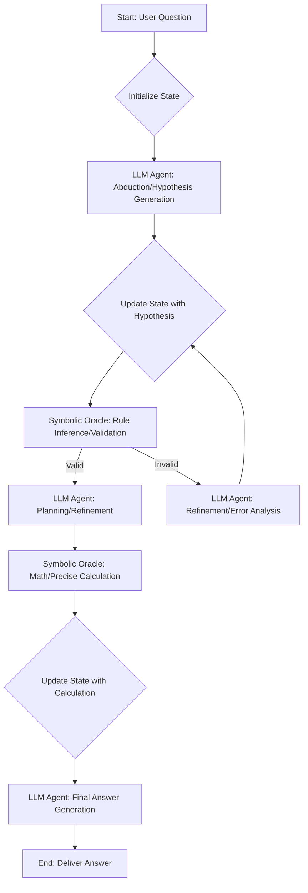

# 💎 全球精英 AI 论文日报 (2026-11-24)

## 🏆 今日深度解剖：A Novel Architecture for Symbolic Reasoning with Decision Trees and LLM Agents
- **级别**: 📄 普通期刊/其他 | **总引用**: 3 | **高影响力引用**: 1
- **阅读链接**: https://www.semanticscholar.org/paper/9cc7aa561345ef229333542b6c242a8c9586f924

好的，作为一名任职于 OpenAI/DeepMind 的首席科学家，我将以最严苛的学术标准，对这篇发表在 arXiv 上的论文进行深度解剖。请注意，我的分析将基于摘要所提供的信息，并辅以对当前 AI 领域前沿的深刻理解。

---

## 深度解剖：A Novel Architecture for Symbolic Reasoning with Decision Trees and LLM Agents

### 1. 【范式转移：解决痛点】

这篇论文的标题和摘要，在当前神经符号（Neuro-Symbolic）AI 研究的浪潮中，试图解决的核心痛点是**“松散耦合”**（loosely coupled）的集成模式。

**当前痛点剖析：**
1.  **LLM 的固有缺陷：** 尽管大型语言模型（LLMs）在生成、泛化和处理非结构化数据方面表现卓越，但其本质是统计模式匹配器。这导致它们在以下方面存在根本性缺陷：
    *   **逻辑一致性与推理链条：** 难以保证多步推理的逻辑严谨性，容易出现“幻觉”（hallucination）和事实性错误。
    *   **可解释性与可审计性：** 决策过程不透明，难以追溯其推理路径，这在医疗、金融等高风险领域是不可接受的。
    *   **精确计算与符号操作：** 对精确的数学计算、符号操作和严格的规则遵循能力较弱。
    *   **知识获取瓶颈（隐性知识）：** 知识以参数形式隐性存储，难以直接编辑、更新或验证。
2.  **传统符号 AI 的局限：** 符号 AI（如专家系统、决策树）在逻辑推理、可解释性和规则遵循方面表现出色，但其局限性在于：
    *   **知识获取瓶颈（显性知识）：** 依赖人工编码规则或从结构化数据中学习，难以处理模糊、不确定或非结构化的信息。
    *   **泛化能力差：** 对训练数据之外的变体或新情境适应性弱，缺乏常识和世界知识。
    *   **脆性（Brittleness）：** 对输入数据的微小变化或规则的微小偏差非常敏感。
3.  **现有神经符号方法的挑战：** 大多数现有方法，无论是将 LLM 作为工具调用器，还是通过提示工程（prompt engineering）试图引导 LLM 进行符号推理，都面临以下问题：
    *   **集成深度不足：** 符号模块和神经模块之间往往是简单的顺序调用或数据转换，缺乏深度的、协同的推理机制。
    *   **状态一致性难题：** 在多步推理中，如何维护跨模块的“信念状态”（belief state）一致性是一个巨大挑战。
    *   **控制流复杂性：** 如何智能地决定何时调用哪个模块，以及如何处理模块间的冲突或不确定性，缺乏统一的协调机制。

**本论文声称的范式转移：**
该论文的核心主张在于，它超越了“松散耦合”的工具调用模式，通过将决策树/随机森林**“嵌入为可调用预言机（callable oracles）”**，并置于**“统一推理系统”**和**“协调多智能体框架”**之下，试图实现更深层次的神经符号融合。这暗示了一种从“LLM + 工具”到“LLM + 深度集成推理模块”的转变，旨在：
*   **提升逻辑严谨性：** 利用符号模块的确定性推理能力，为 LLM 的生成提供逻辑约束和验证。
*   **增强可解释性：** 决策树的路径本身就是可解释的规则，为 LLM 的决策提供透明的支撑。
*   **实现优势互补：** LLM 负责模糊、泛化、归纳和交互式规划，而符号模块负责精确、演绎、因果和规则验证。
*   **统一状态管理：** 通过“中央协调器”维护信念状态一致性，解决多模块协作中的核心难题。

如果其实现真如摘要所言，这确实代表了神经符号 AI 领域的一个重要进步方向，即从简单的“功能叠加”走向“能力融合”。

### 2. 【第一性原理：底层逻辑】

该架构的底层逻辑，可以从以下几个第一性原理进行解构：

1.  **认知任务分解与专业化（Cognitive Task Specialization）：**
    *   **原理：** 复杂的智能行为可以被分解为更小的、专业的认知任务，每个任务由最适合的计算范式来处理。
    *   **体现：** LLM 擅长“系统1”式的快速、直觉、联想、归纳和生成（abductive reasoning, generalization, interactive planning），而决策树/随机森林擅长“系统2”式的慢速、逻辑、演绎、规则遵循和验证（interpretable rule inference, causal logic, logic-grounded validation）。系统通过明确区分这些能力并分配给不同的模块，避免了“一刀切”的低效。

2.  **可信预言机与知识蒸馏（Trusted Oracle & Knowledge Grounding）：**
    *   **原理：** 在需要高精度、高可靠性的场景中，一个经过验证的、确定性的知识源（预言机）可以为不确定性较高的系统提供“事实依据”或“逻辑锚点”。
    *   **体现：** 决策树被视为“可调用预言机”。这意味着它们不是 LLM 试图模仿或生成的文本，而是外部的、可信赖的、具有确定性输出的计算单元。LLM 可以向这些预言机查询，获取精确的符号推理结果，从而将 LLM 的“模糊”输出“锚定”到“精确”的符号逻辑上。这本质上是一种将符号知识“蒸馏”并“固化”为可执行模块的策略。

3.  **多智能体协作与涌现智能（Multi-Agent Collaboration & Emergent Intelligence）：**
    *   **原理：** 通过设计具有特定能力和交互协议的多个智能体，并由一个高级协调器进行管理，可以实现超越单个智能体能力的复杂行为和涌现智能。
    *   **体现：** “协调多智能体框架”和“中央协调器”是这一原理的直接应用。不同的 LLM 智能体（可能针对不同推理模式进行优化）与符号预言机协同工作。协调器负责管理它们的交互、维护共享的“信念状态”，并决定推理的下一步方向。这模拟了人类大脑中不同认知模块的协作，以及一个高级执行功能（executive function）的调度。

4.  **统一状态管理与一致性维护（Unified State Management & Consistency）：**
    *   **原理：** 在一个复杂的、多模块的系统中，维护一个全局一致的“世界模型”或“信念状态”是确保推理连贯性和正确性的关键。
    *   **体现：** “中央协调器维护信念状态一致性”是该架构的基石。这意味着协调器不仅是简单的任务调度器，它还必须具备理解和整合来自不同模块的信息，并解决潜在冲突的能力。这可能涉及到某种形式的共享知识图谱、逻辑数据库或结构化上下文，确保所有智能体都在一个共同的、一致的语境下进行操作。

这些第一性原理共同构成了该架构的底层逻辑，旨在通过结构化的分工、可信的验证和智能的协调，克服单一 AI 范式的局限性，实现更强大、更可靠的通用推理能力。

### 3. 【技术解剖：关键机制】

从摘要中，我们可以推断出以下几个关键技术机制：

1.  **决策树/随机森林作为可调用预言机（Callable Oracles）：**
    *   **机制核心：** 这不是简单地让 LLM 生成决策树的文本描述，而是将预训练或预定义的决策树/随机森林模型封装成一个可执行的 API 或函数。
    *   **调用方式：** LLM 智能体或中央协调器能够以结构化的输入（例如，一组特征值）调用这些预言机，并接收结构化的输出（例如，分类结果、决策路径、规则推断）。这可能通过 LangChain 的 `tool` 抽象、函数调用（Function Calling）机制，或自定义的 RPC 接口实现。
    *   **功能：** 提供确定性的规则推理、因果逻辑判断、分类、回归以及最重要的——**可解释的决策路径**。在 `ProofWriter` 任务中，它用于“逻辑接地树验证”（logic-grounded tree validation），即检查 LLM 推理的逻辑一致性。在 `GSM8k` 中，它可能用于“符号增强”（symbolic augmentation），提供精确的数学步骤或规则。

2.  **LLM 智能体（LLM Agents）：**
    *   **机制核心：** 多个 LLM 实例，每个可能被赋予特定的角色、提示（prompt）和能力。
    *   **角色分工：** 摘要提到“处理归纳推理、泛化和交互式规划”。这暗示可能存在专门的 `AbductionAgent`、`GeneralizationAgent` 和 `PlanningAgent`。
    *   **交互方式：** 这些 LLM 智能体能够与中央协调器通信，接收任务，并调用符号预言机作为工具。它们可能通过生成自然语言、结构化 JSON 或其他中间表示来传递信息。
    *   **学习与适应：** LLM 智能体负责处理非结构化输入、理解上下文、生成假设，并根据预言机的反馈调整其推理路径。

3.  **中央协调器（Central Orchestrator）：**
    *   **机制核心：** 这是整个系统的“大脑”，负责管理推理流程、维护全局状态和协调智能体交互。
    *   **核心功能：**
        *   **信念状态一致性（Belief State Consistency）：** 维护一个共享的、不断更新的“世界模型”或“推理上下文”。这可能是一个结构化的知识图谱、一个逻辑数据库，或一个复杂的字典，记录了当前推理的所有相关事实、假设和中间结果。协调器必须确保所有智能体对当前状态的理解是一致的。
        *   **通信中介（Mediation）：** 管理智能体和预言机之间的信息流。它决定哪个智能体在何时被激活，以及如何将一个模块的输出作为另一个模块的输入。
        *   **推理调度与控制：** 根据当前任务和信念状态，动态地选择和调用合适的 LLM 智能体或符号预言机。这可能涉及一个复杂的规划算法、状态机或基于规则的调度逻辑。
        *   **冲突解决：** 当不同智能体或预言机产生冲突的输出时，协调器需要有机制来解决这些冲突，例如通过优先级、投票或回溯。
    *   **实现方式：** 协调器本身可能是一个高级的 LLM（用于更灵活的调度），也可能是一个传统的算法（如基于规则的专家系统、规划器），或者两者的混合。

4.  **统一推理系统与结构化/非结构化输入处理：**
    *   **机制核心：** 能够无缝地处理来自不同源的数据，并将其整合到推理过程中。
    *   **输入处理：** LLM 智能体擅长处理非结构化文本（如问题描述、上下文），而符号预言机可能需要结构化输入（如特征向量）。协调器负责在两者之间进行必要的转换和映射。
    *   **输出整合：** 符号预言机的精确输出可以作为 LLM 智能体生成响应的约束或事实依据，反之，LLM 的泛化能力可以帮助符号系统处理不完整或模糊的信息。

5.  **逻辑接地树验证（Logic-grounded Tree Validation）与符号增强（Symbolic Augmentation）：**
    *   **机制核心：** 这是符号预言机与 LLM 智能体协同的具体应用模式。
    *   **验证：** 在 `ProofWriter` 等逻辑推理任务中，LLM 可能会生成一个推理步骤或结论。符号预言机（决策树）可以根据预设的逻辑规则或从数据中学习到的逻辑模式，对 LLM 的输出进行验证，指出其逻辑错误或不一致之处，从而引导 LLM 进行修正。
    *   **增强：** 在 `GSM8k` 等数学问题中，LLM 可能会生成一个解题计划或中间步骤。符号预言机可以提供精确的数学运算、公式应用或特定领域的规则，补充 LLM 在精确计算方面的不足，从而“增强”其推理能力。

这些机制共同构成了一个旨在深度融合神经与符号能力的复杂系统，其核心在于智能体的专业化、预言机的确定性以及协调器的全局管理。

### 4. 【批判性思考：大牛视角】

作为首席科学家，我对这篇论文的摘要既抱有期待，也充满了严苛的审视。

**优点与潜力（基于摘要）：**

1.  **方向正确：** 神经符号 AI 是当前 AI 领域最激动人心的前沿之一，也是实现通用人工智能（AGI）的关键路径。该论文提出的架构方向与我们对 AGI 的愿景高度契合，即结合 LLM 的涌现能力与符号系统的严谨性。
2.  **解决核心痛点：** 明确提出解决“松散耦合”问题，并强调“统一推理系统”和“中央协调器”来维护“信念状态一致性”，这抓住了当前神经符号系统集成中最棘手的问题。
3.  **性能提升显著：** 在 `ProofWriter`、`GSM8k` 和 `ARC` 等代表性推理基准上取得的性能提升（+7.2%, +5.3%, +6.0%）是令人鼓舞的。这些基准涵盖了逻辑推理、数学问题解决和抽象推理，表明该架构具有一定的通用性和鲁棒性。
4.  **可解释性承诺：** 强调决策树带来的“可解释规则推理和因果逻辑”，这对于高风险应用（如临床决策支持）至关重要，也是 LLM 亟需弥补的短板。
5.  **应用前景广阔：** 临床决策支持和科学发现是极具价值的应用领域，如果能有效落地，将产生巨大社会效益。

**严苛的质疑与挑战（未在摘要中明确，但作为首席科学家必须追问）：**

1.  **知识获取瓶颈（The Elephant in the Room）：**
    *   **决策树如何构建？** 摘要中未提及决策树/随机森林是如何获取的。它们是人工编码的专家规则？还是从大量结构化数据中学习的？
    *   **如果人工编码：** 这将面临传统专家系统的知识获取瓶颈，难以扩展到复杂或快速变化的领域。
    *   **如果从数据学习：** 那么学习过程的鲁棒性、泛化能力以及对噪声的抵抗力如何？如何确保学习到的规则是“逻辑接地”且“因果”的，而不是简单的统计关联？这又回到了数据驱动的局限性。
    *   **动态性问题：** 这些符号规则是静态的吗？系统能否在运行时动态学习、更新或修正这些规则？如果不能，它将继承符号系统的脆性。

2.  **中央协调器的智能与鲁棒性：**
    *   **协调器本身是什么？** 它是另一个 LLM 吗？如果是，它是否会继承 LLM 的幻觉和不确定性？如果是一个传统的算法（如状态机、规划器），它如何处理模糊、不确定或冲突的信息？
    *   **“信念状态一致性”的实现细节：** 这是最难的部分。如何表示信念状态？如何处理不确定性？如何解决不同智能体或预言机输出的冲突？这需要一个非常精巧的机制，远非简单的字典或列表。
    *   **调度策略：** 协调器如何决定何时调用哪个智能体/预言机？是基于预设规则、启发式算法，还是通过强化学习动态学习？其效率和最优性如何？

3.  **“统一推理系统”的深度：**
    *   **中间表示：** 神经模块和符号模块之间是否存在一个共同的、语义丰富的中间表示（Intermediate Representation）？如果只是简单的文本到结构化数据，或结构化数据到文本的转换，那么“统一”的深度可能不足，仍存在信息损失和语义鸿沟。
    *   **双向反馈：** 符号预言机如何有效地“指导”LLM 进行修正？仅仅是指出错误，还是能提供具体的修正建议？LLM 如何将符号反馈有效地整合到其生成过程中？

4.  **可扩展性与复杂性：**
    *   **决策树的局限：** 对于高维、连续或非常复杂的决策空间，决策树的表达能力有限，容易过拟合或变得过于庞大难以管理。随机森林有所缓解，但其“可解释性”会下降。
    *   **多智能体框架的复杂性：** 随着智能体数量和交互复杂度的增加，系统的调试、维护和性能优化将变得极其困难。

5.  **通用性与领域适应性：**
    *   **“通用目的神经符号推理”：** 这是一个非常宏大的目标。摘要中列举的三个基准虽然多样，但仍是特定类型的推理任务。该架构如何应对更广泛的、开放域的、常识性的推理任务？
    *   **领域知识依赖：** 决策树的有效性高度依赖于领域知识的编码或学习。对于缺乏明确规则或结构化数据的领域，该架构的优势是否依然存在？

6.  **计算成本：** 运行多个 LLM 智能体并频繁调用外部预言机，其计算资源消耗和延迟将是巨大的。这在实际部署中是一个重要考量。

**总结：**
这篇论文的摘要描绘了一个令人兴奋的愿景，即通过深度集成神经与符号能力，构建一个更强大、更可靠、更可解释的通用推理系统。其在多个基准上的性能提升令人瞩目。然而，作为首席科学家，我更关注其核心机制的实现细节、潜在的工程挑战以及其在知识获取、协调器智能和真正通用性方面的深层局限。我期待看到论文正文如何详细阐述这些关键问题，特别是关于符号知识的来源、协调器的内部逻辑以及神经与符号模块之间真正的“统一”程度。

### 5. 【开发者行动手册：LangGraph/Agent 落地】

如果我现在要将摘要中描述的架构落地，我会立即想到使用 LangGraph 或类似的 Agent 框架（如 AutoGen, CrewAI），结合 LangChain 的工具（Tools）和函数调用（Function Calling）能力。以下是我的行动手册：

1.  **核心框架选择：LangGraph**
    *   **原因：** LangGraph 提供了强大的状态机和图式编程模型，非常适合构建多智能体、多步骤、有条件分支和循环的推理流程。它的 `state` 概念天然适合维护“信念状态一致性”。
    *   **架构映射：**
        *   **节点（Nodes）：** 每个 LLM 智能体和每个符号预言机都将是一个独立的节点。
        *   **边（Edges）：** 定义节点之间的转换逻辑，即推理流程的路径。
        *   **图（Graph）：** 整个推理系统就是一张有向图，中央协调器的逻辑体现在图的遍历和状态管理上。

2.  **实现中央协调器（Central Orchestrator）：**
    *   **LangGraph State：** 定义一个共享的 `TypedDict` 作为 LangGraph 的 `state`。这个 `state` 将包含所有智能体共享的信息，例如：
        ```python
        from typing import List, Dict, Any, Literal, TypedDict

        class AgentState(TypedDict):
            question: str
            intermediate_steps: List[str]
            symbolic_facts: Dict[str, Any] # 存储决策树输出的结构化事实
            llm_hypothesis: str
            validation_result: Literal["VALID", "INVALID", "UNCERTAIN"]
            current_task: str # 协调器决定下一步要做的任务
            # ... 更多用于维护信念状态的字段
        ```
    *   **协调器逻辑：** 协调器本身不是一个独立的节点，而是**LangGraph 的图结构和条件边（conditional edges）的组合**。
        *   **入口节点：** 接收初始问题，初始化 `AgentState`。
        *   **条件路由：** 根据 `state` 中的 `current_task` 或 `validation_result`，动态决定下一个要执行的节点（LLM 智能体或符号预言机）。
        *   **状态更新：** 每个节点执行完毕后，都会更新 `AgentState`，协调器通过 `state` 的变化来感知和驱动流程。
        *   **循环与回溯：** 利用 LangGraph 的循环能力，实现 LLM 智能体根据符号预言机的反馈进行迭代修正的机制。

3.  **实现 LLM 智能体（LLM Agents）：**
    *   **Agent 定义：** 每个 LLM 智能体都是 LangGraph 中的一个节点，封装一个 `ChatOpenAI` 或 `ChatGoogleGenerativeAI` 实例。
    *   **角色与提示：** 为每个智能体设计专门的系统提示（System Prompt），明确其角色（如 `AbductionAgent` 负责生成假设，`PlanningAgent` 负责制定步骤）。
    *   **工具调用（Tool Calling）：** 这是关键。每个 LLM 智能体都将配备调用符号预言机的能力。
        *   使用 `create_openai_functions_agent` 或 `create_react_agent`。
        *   将符号预言机封装为 LangChain `tool`，并提供给 LLM 智能体。
        *   LLM 智能体在其推理过程中，可以决定何时调用这些工具，并传递结构化参数。
    *   **输出格式：** 强制 LLM 智能体输出结构化数据（如 JSON），以便协调器和后续节点能够解析和利用。可以使用 Pydantic 输出解析器。

4.  **实现符号预言机（Symbolic Oracles - Decision Trees/Random Forests）：**
    *   **封装为 LangChain Tool：**
        *   使用 `scikit-learn` 训练决策树或随机森林模型。
        *   编写 Python 函数，接收结构化输入（例如，`{"feature_a": 10, "feature_b": "X"}`），执行模型预测，并返回结构化输出（例如，`{"prediction": "Class A", "rule_path": ["feature_a > 5", "feature_b == X"]}`）。
        *   使用 `@tool` 装饰器或 `Tool` 类将其封装为 LangChain 工具，并提供详细的 `description` 和 `args_schema`。
    *   **预言机类型：**
        *   **`LogicValidationOracle`：** 接收 LLM 提出的逻辑命题或推理步骤，通过预设的逻辑规则树进行验证，返回 `VALID` 或 `INVALID`。
        *   **`MathSolverOracle`：** 接收数学表达式或数值，执行精确计算，返回结果。
        *   **`RuleInferenceOracle`：** 接收一组事实，通过决策树推断出新的事实或分类结果。
    *   **数据源：** 决策树的数据来源是关键。可以是：
        *   **专家知识编码：** 手动将领域规则转换为决策树结构。
        *   **结构化数据学习：** 从大量的历史数据中训练决策树。
        *   **LLM 辅助生成：** LLM 辅助专家生成初始规则，再由人工或自动化工具转换为决策树。

5.  **通信与数据流：**
    *   **结构化通信：** 强制所有智能体和预言机通过结构化数据（JSON、Pydantic 模型）进行输入和输出。这对于协调器理解和整合信息至关重要。
    *   **共享状态：** LangGraph 的 `state` 是所有信息流动的核心。每个节点读取当前 `state`，执行操作，然后更新 `state`。
    *   **中间步骤记录：** `intermediate_steps` 字段在 `AgentState` 中非常重要，用于记录推理过程，便于调试和可解释性。

6.  **验证与迭代循环：**
    *   **验证节点：** 在 LangGraph 中设置一个专门的 `ValidationNode`，它调用 `LogicValidationOracle`。
    *   **条件分支：** 如果 `validation_result` 为 `INVALID`，则将流程路由回 `RefinementAgent`（一个 LLM 智能体），并提供验证失败的反馈，让其重新思考和修正。
    *   **成功路径：** 如果 `validation_result` 为 `VALID`，则继续到下一个推理步骤或最终答案生成。

**示例 LangGraph 流程草图：**



**挑战与注意事项：**

*   **Prompt Engineering：** 如何设计 LLM 智能体的提示，使其能够有效地利用工具，并理解符号预言机的反馈，是成功的关键。
*   **错误处理：** 如何处理 LLM 幻觉、工具调用失败、符号预言机返回不确定结果等情况？协调器需要健壮的错误处理机制。
*   **性能优化：** 频繁的 LLM 调用和工具调用会带来显著的延迟和成本。需要考虑缓存、并行化和模型选择。
*   **可解释性：** 尽管决策树本身可解释，但整个多智能体系统的端到端可解释性仍是一个挑战。需要记录详细的推理路径和状态变化。

通过上述方法，我们可以利用现有工具和框架，将这篇论文摘要中描述的神经符号架构从概念变为可操作的原型。关键在于对每个组件的职责进行清晰定义，并设计一个智能的协调机制来管理它们之间的交互和共享状态。

---
